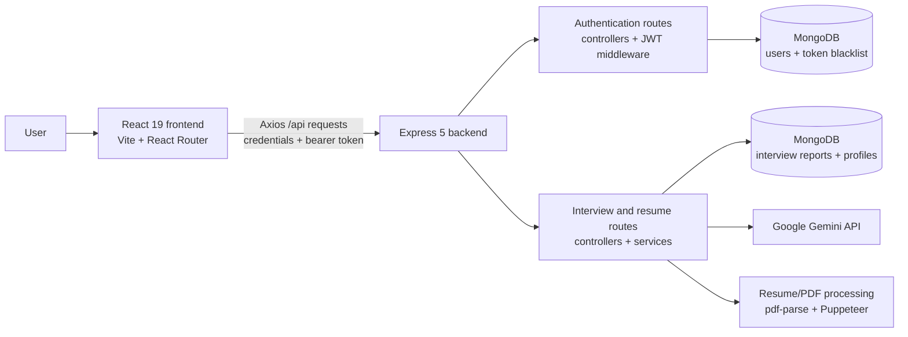
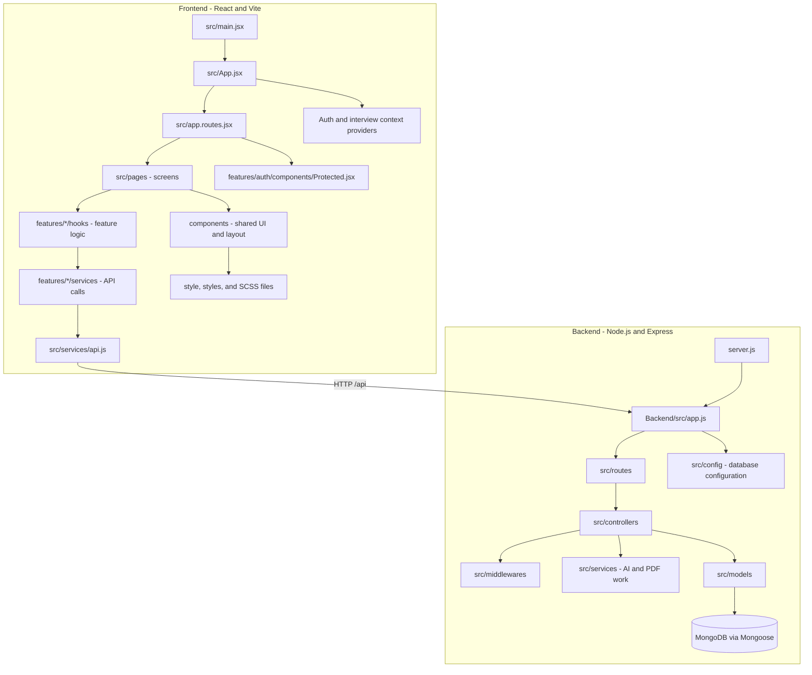

# 🚀 AI Interview Prep & Resume Generator

An AI-powered interview preparation and ATS-friendly resume platform. The project is split into a **React/Vite frontend** and a **Node.js/Express backend**, with **MongoDB** for persistence and **Google Gemini** for AI-generated preparation content.

## ✨ Features

- Account registration, login, and protected pages using JWT authentication.
- Resume and job-description analysis with tailored interview strategies, questions, roadmaps, and skill-gap insights.
- ATS-oriented resume generation and PDF downloads.
- React UI with reusable components and SCSS styling.

## 🏗️ Architecture

### System architecture

This diagram shows the main runtime components and how requests move between them. The browser communicates with the Express API; the API uses MongoDB for persistent data and Gemini for AI generation. PDF parsing and rendering run in the backend.



### Login and protected-page flow

```mermaid
sequenceDiagram
    actor User
    participant UI as AuthPage (React)
    participant Auth as Auth hook/context
    participant API as Express /api/auth
    participant DB as MongoDB
    participant Guard as Protected route

    User->>UI: Submit email and password
    UI->>Auth: handleLogin(credentials)
    Auth->>API: POST /api/auth/login
    API->>DB: Find user and verify password
    DB-->>API: User record
    API-->>Auth: User data + JWT; set HTTP-only cookie
    Auth-->>UI: Set current user
    UI->>Guard: Navigate to /
    Guard-->>User: Render application when user is authenticated
```

On application startup, the auth hook requests `GET /api/auth/get-me` to restore the current session. A 404 usually means the frontend is reaching a host that does not serve the backend API; configure `VITE_API_URL` to the deployed backend origin and redeploy the frontend. A missing session can return an authorization response and should not be confused with a missing route.

### Source code map



### Backend request path

1. `Backend/server.js` loads environment variables, connects to MongoDB, and starts the Express server.
2. `Backend/src/app.js` configures JSON parsing, cookies, CORS, the health endpoint, API routers, and error handling.
3. Routers in `Backend/src/routes/` map API paths to controllers. Authentication routes are mounted at `/api/auth`, interview routes at `/api/interview`, and resume/profile routes at `/api/resume`.
4. Controllers validate requests and coordinate middleware, Mongoose models, and backend services.
5. Services perform operations such as Gemini generation and PDF work; models persist application data in MongoDB.

### Frontend request path

1. `Frontend/src/main.jsx` mounts the React application.
2. `Frontend/src/App.jsx` provides auth/interview state and the router.
3. `Frontend/src/app.routes.jsx` maps URLs to pages; protected application pages are wrapped by the auth guard.
4. Pages and feature hooks call feature API modules under `src/features/**/services/`.
5. Those API modules use the shared Axios client in `src/services/api.js`, which adds credentials and the saved bearer token when available.

## 🧰 Technology stack

| Area | Technologies |
| --- | --- |
| Frontend | React 19, Vite 7, React Router 7, Axios, Sass/SCSS |
| Backend | Node.js, Express 5, Mongoose 9 |
| Data | MongoDB |
| Authentication | JWT, bcryptjs, HTTP-only cookies |
| AI and documents | Google Gemini (`@google/genai`), `pdf-parse`, Puppeteer |

## 📂 Repository layout

```text
.
├── Backend/
│   ├── server.js                 # Loads env, connects to DB, starts server
│   ├── src/
│   │   ├── app.js                # Express setup and router mounting
│   │   ├── config/               # Database configuration
│   │   ├── controllers/          # HTTP request handlers
│   │   ├── middlewares/          # Auth, uploads, rate limits, etc.
│   │   ├── models/               # Mongoose schemas
│   │   ├── routes/               # Auth, interview, resume/profile routes
│   │   └── services/             # AI and document processing
│   └── tests/                    # Backend tests
├── Frontend/
│   ├── src/
│   │   ├── App.jsx               # Providers and router entry
│   │   ├── app.routes.jsx        # Route definitions
│   │   ├── components/          # Shared UI and layout
│   │   ├── features/             # Auth and interview feature modules
│   │   ├── pages/                # Page-level screens
│   │   ├── services/api.js       # Shared Axios client
│   │   └── styles/               # Application styles
│   ├── .env.example              # Frontend API URL example
│   └── vite.config.js            # Development server and API proxy
├── netlify.toml                  # Netlify build/deploy configuration
└── README.md
```

## ⚙️ Getting started

### Prerequisites

- Node.js 18 or later
- MongoDB connection string (local or hosted)
- Google Gemini API key

### 1. Configure and run the backend

```bash
cd Backend
npm install
```

Create `Backend/.env` with the values for your environment:

```env
PORT=3000
MONGO_URI=your_mongodb_connection_string
JWT_SECRET=use_a_long_random_secret
GOOGLE_GENAI_API_KEY=your_gemini_api_key
FRONTEND_URL=http://localhost:5173
```

Start the backend:

```bash
npm run dev
```

The local API is available at `http://localhost:3000`.

### 2. Configure and run the frontend

```bash
cd Frontend
npm install
npm run dev
```

For local development, the Vite config proxies `/api` requests to `http://localhost:3000`. To use a different local backend, update the proxy target in `Frontend/vite.config.js`.

For deployment, set `VITE_API_URL` in the frontend host's environment settings to the **backend origin**, for example `https://your-backend.onrender.com` (no `/api` suffix), then rebuild and redeploy the frontend. See [`Frontend/API_CONFIGURATION.md`](Frontend/API_CONFIGURATION.md) for details.

## 🔌 Main API routes

| Method | Route | Purpose |
| --- | --- | --- |
| `POST` | `/api/auth/register` | Register an account |
| `POST` | `/api/auth/login` | Authenticate and issue a session |
| `GET` | `/api/auth/logout` | End the session |
| `GET` | `/api/auth/get-me` | Get the current authenticated user |
| `GET` / `POST` | `/api/interview/` | List or create interview reports |
| `GET` | `/api/interview/report/:interviewId` | Fetch an interview report |
| `POST` | `/api/interview/resume/pdf/:interviewReportId` | Generate/download a tailored PDF resume |
| `...` | `/api/resume/*` | Resume/profile endpoints (see `Backend/src/routes/resumeProfile.routes.js`) |

## 🧪 Checks

From `Frontend/`:

```bash
npm run lint
npm run build
```

From `Backend/`:

```bash
npm test
```

## 📄 License

ISC. See the repository license file.
